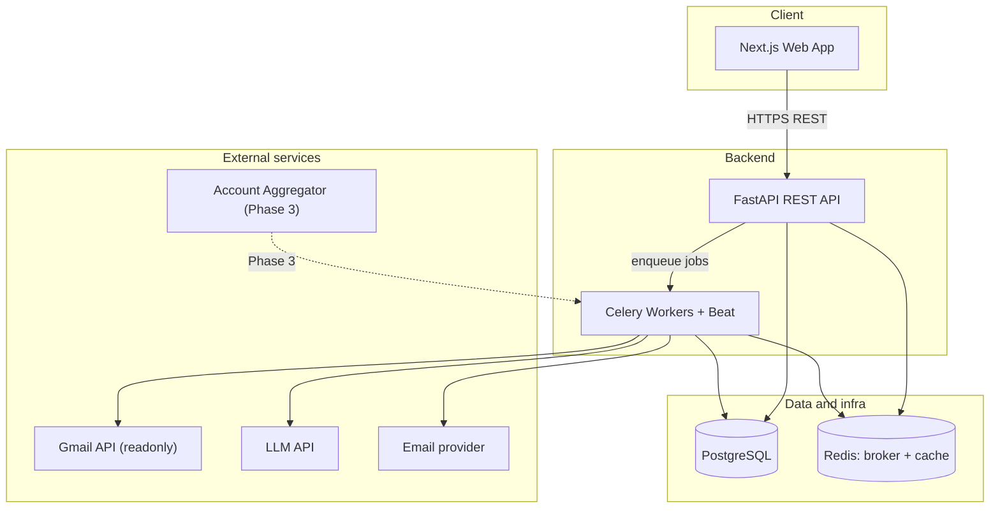
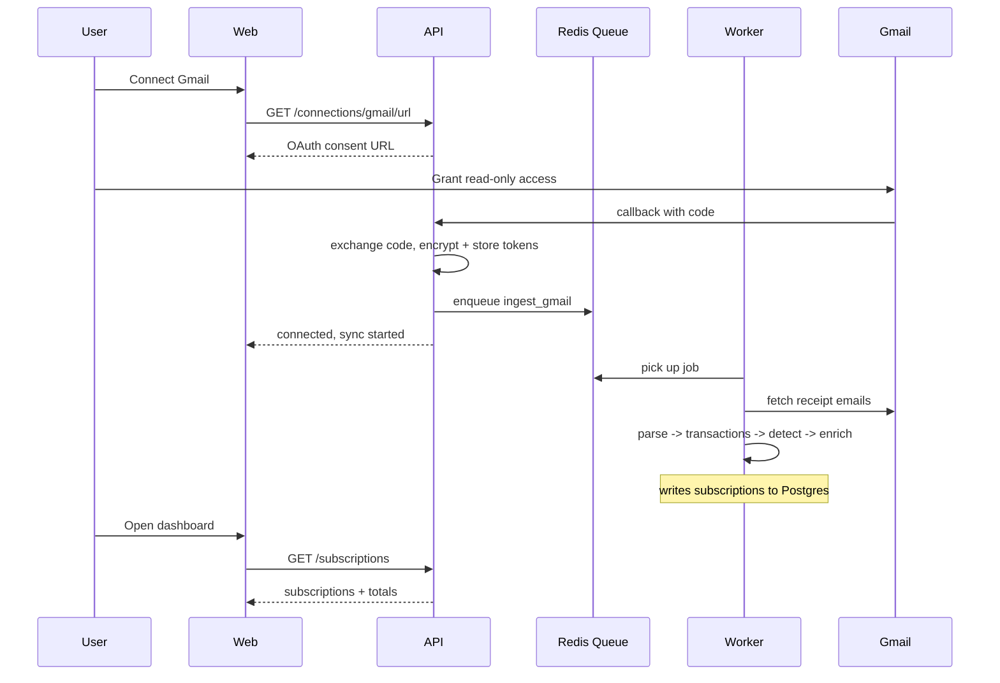

# Architecture

This document describes the system architecture for Subscription Auditor. It covers the high-level design, every component, how data flows, and the reasoning behind the key decisions.

Related reading: [PROJECT_STRUCTURE.md](PROJECT_STRUCTURE.md), [DATA_MODEL.md](DATA_MODEL.md), [PIPELINE.md](PIPELINE.md).

---

## 1. Guiding principles

1. **Source-agnostic core.** Every data source (Gmail now, Account Aggregator later) normalizes into one `transactions` table. The detection engine is pure and does not know or care about the source.
2. **Async by default.** Pulling email or bank data is slow and rate-limited. It never happens inside an HTTP request; it runs in background workers.
3. **Human in the loop for destructive actions.** The app reminds and instructs; it does not silently cancel things in the MVP.
4. **Privacy first.** This is financial data. Least-privilege scopes, encryption at rest, and a real delete flow are not optional.

---

## 2. High-level diagram

---

## 3. Components

### 3.1 Frontend (Next.js)
- Server-rendered React app with Tailwind.
- Screens: login/signup, connect Gmail, dashboard (spend summary + subscription list), subscription detail, settings.
- Talks to the backend over a typed REST client. Holds the JWT and attaches it to requests.

### 3.2 Backend API (FastAPI)
The synchronous request/response layer. Responsibilities:
- Auth (signup, login, JWT issue/verify).
- Gmail OAuth handshake and encrypted token storage.
- Serving subscriptions, totals, alerts to the dashboard.
- Enqueueing background jobs (sync, re-scan).
- Account data deletion.

It is intentionally thin: anything slow is delegated to workers.

### 3.3 Workers (Celery + Beat)
The asynchronous engine. Three core tasks:
- `ingest_gmail` - pull and parse receipt emails into `transactions`.
- `detect_subscriptions` - run the recurrence engine, write `subscriptions`.
- `scan_renewals` - scheduled (Celery Beat) nightly scan that creates and sends renewal reminders.

### 3.4 Services (shared business logic)
Importable modules used by both API and workers:
- `gmail.py` - OAuth + email search/parse.
- `detection.py` - the pure, unit-tested recurrence engine.
- `enrichment.py` - merchant-name cleanup, categorization, logo lookup (LLM + cache + rule-based fallback).
- `alerts.py` - reminder scheduling and sending.

### 3.5 Data stores
- **PostgreSQL** - the system of record. Relational data (users, connections, transactions, subscriptions, alerts) fits perfectly.
- **Redis** - Celery broker/result backend, plus caching (e.g. enriched merchant names) and rate limiting.

### 3.6 External services
- **Gmail API** - read-only scope, the Phase 1 data source.
- **LLM API** - normalizes messy merchant strings; used sparingly and cached for cost.
- **Email provider** (Resend/SES) - sends renewal reminders.
- **Account Aggregator** (Setu/Finvu/Perfios) - the Phase 3 data source; feeds the same `transactions` pipeline.

---

## 4. Request vs background separation

The user never waits on a slow Gmail sync; the dashboard simply fills in as the worker finishes.

---

## 5. Why these choices

- **FastAPI** - great async support, Pydantic validation, fast to build, strong typing.
- **Celery + Redis** - mature, well-understood background jobs plus scheduled (Beat) tasks for the nightly renewal scan.
- **Postgres** - relational data with clear relationships; easy to host on Supabase/Neon.
- **Next.js** - fast to build a clean dashboard, SSR, good DX.
- **Pluggable sources** - the single most important decision; it is what lets the MVP grow into the fundable product without a rewrite.

---

## 6. Deployment (reference)

| Component | Suggested host |
|---|---|
| Frontend | Vercel |
| API + workers | Render / Railway / Fly.io |
| Postgres | Supabase / Neon / managed PG |
| Redis | Upstash / managed Redis |

Keep secrets (JWT key, token-encryption key, API keys) in the host's secrets manager, never in the repo.
