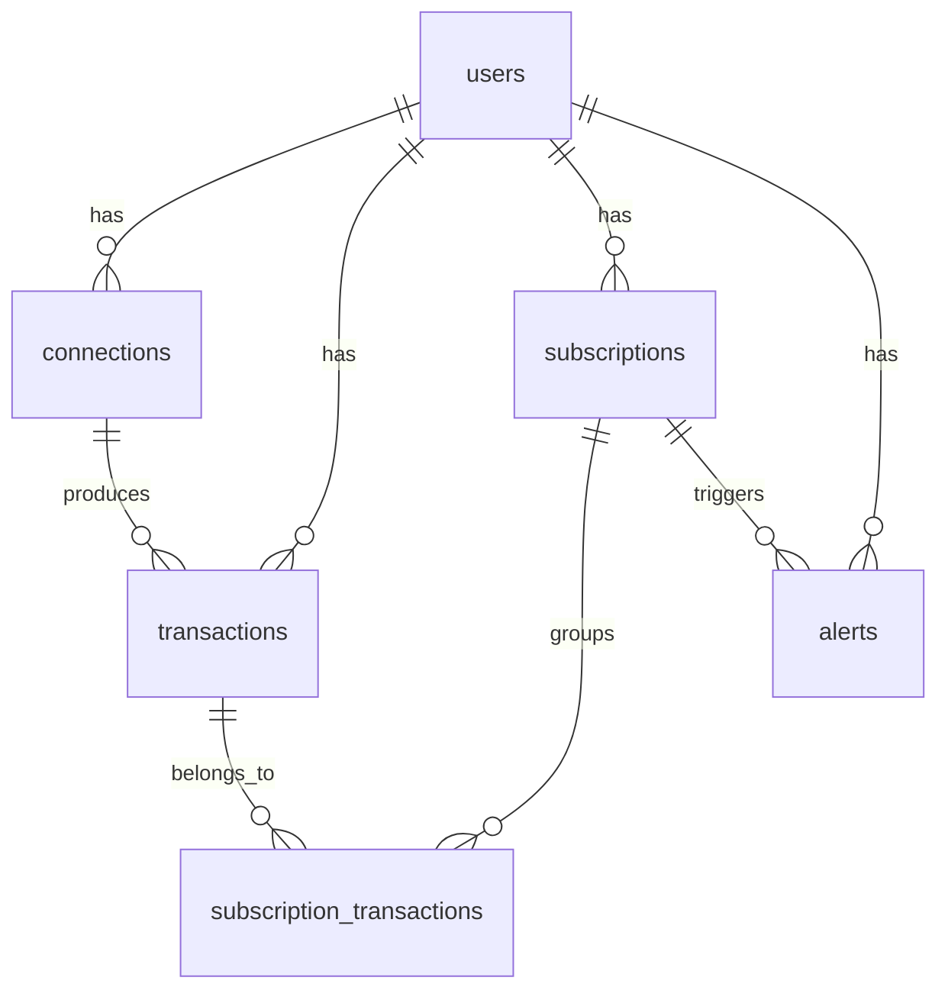

# Data Model

The database schema for Subscription Auditor. The design centers on one principle: **every data source normalizes into `transactions`**, and `subscriptions` are *derived* from transactions by the detection engine.

Related reading: [PIPELINE.md](PIPELINE.md), [ARCHITECTURE.md](ARCHITECTURE.md).

---

## Entity relationship diagram



---

## Tables

### `users`
The account holder.

| Column | Type | Notes |
|---|---|---|
| id | uuid (PK) | |
| email | text unique | login identity |
| password_hash | text | bcrypt/argon2 |
| created_at | timestamptz | |

### `connections`
A linked data source for a user. Phase 1 only has `type = 'gmail'`; Phase 3 adds `'aa'`.

| Column | Type | Notes |
|---|---|---|
| id | uuid (PK) | |
| user_id | uuid (FK -> users) | |
| type | text | 'gmail' \| 'aa' |
| access_token_enc | bytea | AES-GCM encrypted |
| refresh_token_enc | bytea | AES-GCM encrypted |
| expires_at | timestamptz | token expiry |
| status | text | 'active' \| 'revoked' \| 'error' |
| last_synced_at | timestamptz | |

Tokens are **never** stored in plaintext. See [SECURITY.md](SECURITY.md).

### `transactions`
The source-agnostic heart of the system. Gmail receipts and (later) bank transactions both land here in the same shape.

| Column | Type | Notes |
|---|---|---|
| id | uuid (PK) | |
| user_id | uuid (FK -> users) | |
| connection_id | uuid (FK -> connections) | |
| source | text | 'gmail' \| 'aa' |
| raw_merchant | text | e.g. "NETFLIX COM 94 LOS GAT" |
| amount | numeric(12,2) | |
| currency | text | e.g. 'INR' |
| occurred_at | timestamptz | charge date |
| raw_ref | text | source id (email id / txn id) for dedupe |
| created_at | timestamptz | |

Index on `(user_id, raw_merchant, occurred_at)` to support grouping. `raw_ref` is unique per connection to prevent duplicate ingestion.

### `subscriptions`
Derived by the detection engine from grouped transactions.

| Column | Type | Notes |
|---|---|---|
| id | uuid (PK) | |
| user_id | uuid (FK -> users) | |
| merchant_name | text | cleaned, e.g. "Netflix" |
| category | text | e.g. "Entertainment" |
| logo_url | text | |
| amount | numeric(12,2) | typical charge |
| currency | text | |
| cadence | text | 'monthly' \| 'yearly' \| 'weekly' \| 'unknown' |
| first_seen_at | timestamptz | earliest charge |
| last_charge_at | timestamptz | most recent charge |
| next_renewal_at | timestamptz | predicted |
| status | text | 'active' \| 'unused' \| 'trial' \| 'cancelled' |
| confidence_score | numeric(3,2) | 0..1 detection confidence |

### `subscription_transactions`
Link table: which transactions formed a subscription. Keeps the audit trail and lets the UI show charge history.

| Column | Type | Notes |
|---|---|---|
| subscription_id | uuid (FK) | |
| transaction_id | uuid (FK) | |

Composite primary key `(subscription_id, transaction_id)`.

### `alerts`
Scheduled or sent notifications.

| Column | Type | Notes |
|---|---|---|
| id | uuid (PK) | |
| user_id | uuid (FK -> users) | |
| subscription_id | uuid (FK -> subscriptions) | |
| type | text | 'renewal' \| 'trial_ending' \| 'price_hike' \| 'unused' |
| scheduled_for | timestamptz | |
| sent_at | timestamptz | null until sent |
| channel | text | 'email' (Phase 1); 'whatsapp' \| 'push' later |

---

## Reference DDL (illustrative)

```sql
CREATE TABLE users (
  id            uuid PRIMARY KEY DEFAULT gen_random_uuid(),
  email         text UNIQUE NOT NULL,
  password_hash text NOT NULL,
  created_at    timestamptz NOT NULL DEFAULT now()
);

CREATE TABLE connections (
  id                uuid PRIMARY KEY DEFAULT gen_random_uuid(),
  user_id           uuid NOT NULL REFERENCES users(id) ON DELETE CASCADE,
  type              text NOT NULL,
  access_token_enc  bytea,
  refresh_token_enc bytea,
  expires_at        timestamptz,
  status            text NOT NULL DEFAULT 'active',
  last_synced_at    timestamptz
);

CREATE TABLE transactions (
  id            uuid PRIMARY KEY DEFAULT gen_random_uuid(),
  user_id       uuid NOT NULL REFERENCES users(id) ON DELETE CASCADE,
  connection_id uuid NOT NULL REFERENCES connections(id) ON DELETE CASCADE,
  source        text NOT NULL,
  raw_merchant  text NOT NULL,
  amount        numeric(12,2) NOT NULL,
  currency      text NOT NULL DEFAULT 'INR',
  occurred_at   timestamptz NOT NULL,
  raw_ref       text NOT NULL,
  created_at    timestamptz NOT NULL DEFAULT now(),
  UNIQUE (connection_id, raw_ref)
);
CREATE INDEX idx_txn_group ON transactions (user_id, raw_merchant, occurred_at);

CREATE TABLE subscriptions (
  id               uuid PRIMARY KEY DEFAULT gen_random_uuid(),
  user_id          uuid NOT NULL REFERENCES users(id) ON DELETE CASCADE,
  merchant_name    text NOT NULL,
  category         text,
  logo_url         text,
  amount           numeric(12,2) NOT NULL,
  currency         text NOT NULL DEFAULT 'INR',
  cadence          text NOT NULL DEFAULT 'unknown',
  first_seen_at    timestamptz,
  last_charge_at   timestamptz,
  next_renewal_at  timestamptz,
  status           text NOT NULL DEFAULT 'active',
  confidence_score numeric(3,2) NOT NULL DEFAULT 0
);

CREATE TABLE subscription_transactions (
  subscription_id uuid NOT NULL REFERENCES subscriptions(id) ON DELETE CASCADE,
  transaction_id  uuid NOT NULL REFERENCES transactions(id) ON DELETE CASCADE,
  PRIMARY KEY (subscription_id, transaction_id)
);

CREATE TABLE alerts (
  id              uuid PRIMARY KEY DEFAULT gen_random_uuid(),
  user_id         uuid NOT NULL REFERENCES users(id) ON DELETE CASCADE,
  subscription_id uuid NOT NULL REFERENCES subscriptions(id) ON DELETE CASCADE,
  type            text NOT NULL,
  scheduled_for   timestamptz NOT NULL,
  sent_at         timestamptz,
  channel         text NOT NULL DEFAULT 'email'
);
```

Migrations are managed with Alembic (`backend/alembic/versions/`).

---

## Data lifecycle and deletion

When a user disconnects a source or deletes their account, all rows cascade-delete via the foreign keys above. The delete flow is a hard requirement for trust and for Google OAuth verification - see [SECURITY.md](SECURITY.md).
