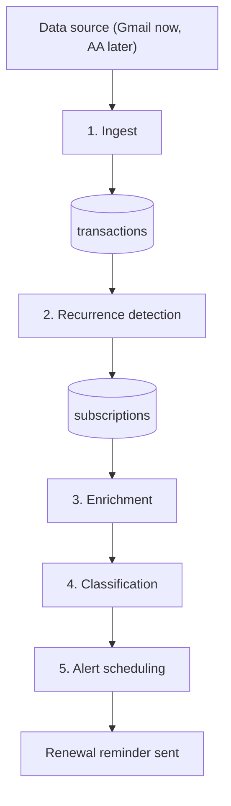
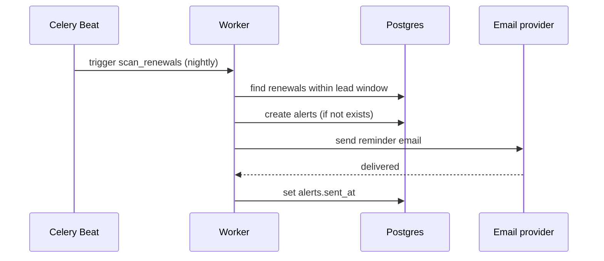

# The Core Pipeline

This is the engine of Subscription Auditor: how raw email receipts become clean, flagged subscriptions with renewal reminders. The same pipeline serves bank transactions in Phase 3 because everything normalizes into `transactions` first.

Related reading: [DATA_MODEL.md](DATA_MODEL.md), [ARCHITECTURE.md](ARCHITECTURE.md).

---

## Overview



Each numbered stage is described below.

---

## Stage 1: Ingest

**Task:** `ingest_gmail` (Celery worker)

1. Load the user's Gmail connection and decrypt tokens.
2. Search the inbox for receipt/renewal emails. Example query terms:
   `subscription OR receipt OR invoice OR "your payment" OR "renews" OR "subscription confirmed"`.
3. For each matching email, extract:
   - merchant/sender -> `raw_merchant`
   - amount + currency -> `amount`, `currency`
   - date -> `occurred_at`
   - message id -> `raw_ref` (used for dedupe)
4. Insert into `transactions`, skipping any `(connection_id, raw_ref)` that already exists.

**Important:** store only the extracted fields, not full email bodies. See [SECURITY.md](SECURITY.md).

---

## Stage 2: Recurrence detection

**Task:** `detect_subscriptions` -> `services/detection.py` (pure, unit-tested)

1. Group transactions for the user by a normalized merchant key (lowercase, strip numbers/city codes).
2. For each group, decide if it is recurring:
   - at least 2 charges
   - amounts within a small tolerance (e.g. +-10%)
   - roughly regular interval:
     - ~28-31 days -> `monthly`
     - ~7 days -> `weekly`
     - ~365 days -> `yearly`
3. Compute:
   - `cadence`
   - `amount` (median/typical charge)
   - `first_seen_at`, `last_charge_at`
   - `next_renewal_at = last_charge_at + interval`
   - `confidence_score` (how regular the interval and amount are)
4. Upsert a `subscriptions` row and link the contributing transactions via `subscription_transactions`.

### Why the engine is pure
`detection.py` takes a list of transaction records and returns subscription candidates. It performs no DB or network I/O, so it can be tested exhaustively with synthetic inputs (`tests/test_detection.py`). This is the most important piece of logic in the product and must be reliable.

Example signature:
```python
def detect_subscriptions(transactions: list[Txn]) -> list[SubscriptionCandidate]:
    ...
```

---

## Stage 3: Enrichment

**Module:** `services/enrichment.py`

Turns a messy `raw_merchant` into something a human recognizes:
- `"NETFLIX COM 94 LOS GAT"` -> name `Netflix`, category `Entertainment`, logo URL.
- Strategy: check a local merchant lookup table/cache first; if unknown, call the LLM to normalize; cache the result so the LLM is called at most once per unique merchant.
- **Fallback:** if no LLM key is configured, use heuristics (title-case, strip trailing codes). The product still works without an LLM.

---

## Stage 4: Classification

Assigns `status` and prepares flags:
- `active` - regular, recent charges.
- `unused` - charges continue but no recent engagement signal (best-effort in MVP; richer in Phase 2).
- `trial` - first charge matches a known trial-to-paid pattern.
- `price_hike` - latest amount jumped notably vs. history.

In Phase 1 this is simple rule-based tagging; Phase 2 deepens it (see [PHASE_2_RETENTION.md](phases/PHASE_2_RETENTION.md)).

---

## Stage 5: Alert scheduling

**Task:** `scan_renewals` (Celery Beat, nightly)

1. Query subscriptions whose `next_renewal_at` falls within the user's reminder lead time (default 2 days).
2. Create an `alerts` row (`type = 'renewal'`) if one does not already exist for that cycle.
3. Hand off to `services/alerts.py`, which sends the email via the email provider and stamps `sent_at`.



---

## End-to-end example

1. User connects Gmail. `ingest_gmail` finds 3 Netflix receipts (Sep, Oct, Nov, ~Rs 199 each).
2. `detect_subscriptions` groups them: cadence `monthly`, `next_renewal_at` = Dec 1, confidence 0.95.
3. `enrichment` labels it `Netflix` / `Entertainment` with a logo.
4. `classification` marks it `active`.
5. On Nov 29, `scan_renewals` emails the user: "Netflix renews in 2 days for Rs 199."

That is the entire value loop.
