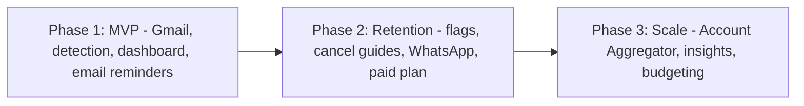
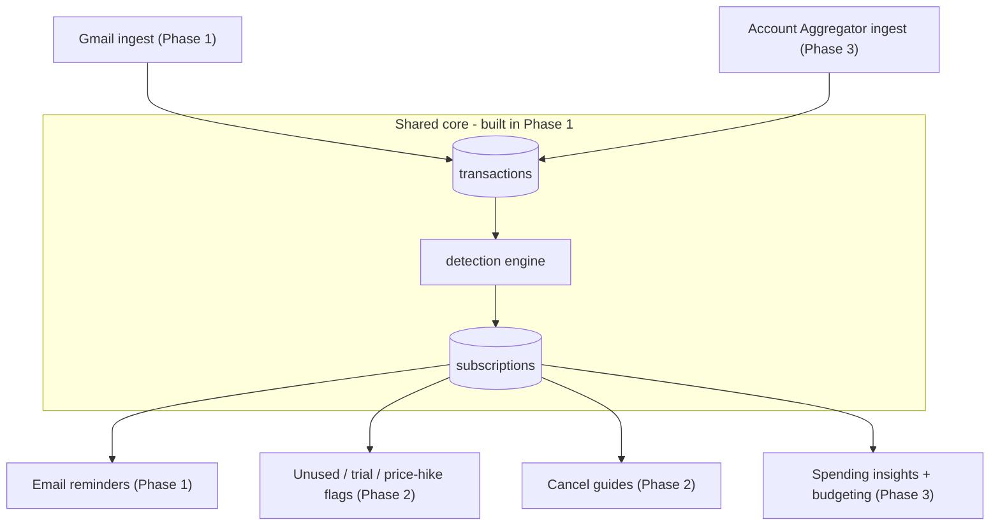

# Roadmap

Subscription Auditor is built in three phases. Each phase stands on its own and ships something users can use, and each one reuses the same core (the `transactions` table and the detection pipeline).

Related reading: [ARCHITECTURE.md](ARCHITECTURE.md), and the phase docs linked below.

---

## Phases at a glance

| Phase | Theme | Timeline | Goal |
|---|---|---|---|
| [Phase 1: MVP](phases/PHASE_1_MVP.md) | Prove the "whoa moment" | 3-4 weeks | Connect Gmail, show real subscriptions and total, send renewal reminders |
| [Phase 2: Retention](phases/PHASE_2_RETENTION.md) | Trust and stickiness | 4-6 weeks | Smarter flags, cancel guides, WhatsApp/push alerts, first paid plan |
| [Phase 3: Scale](phases/PHASE_3_SCALE.md) | Full financial picture | 2-3 months | Account Aggregator bank data, spending insights, budgeting, savings-based pricing |

---

## How the phases build on each other

Adding a new data source in Phase 3 means writing one new ingest module. Everything downstream already works.

---

## Exit criteria for each phase

### Phase 1 is done when
- A real user connects Gmail and sees their actual subscriptions with a believable monthly total.
- Renewal reminder emails arrive on time.
- Disconnect and account deletion work.
- 10-20 friends/early users have tried it, and most find at least one subscription they forgot about.

### Phase 2 is done when
- Users return weekly or act on alerts (retention signal).
- At least some users pay for the premium plan.
- Cancel guides cover the top 50 merchants used by your users.

### Phase 3 is done when
- Account Aggregator connection works in production with a licensed provider.
- Users see a complete picture (bank + email) and use insights/budgeting.
- Metrics (users, retention, revenue) are strong enough to support a fundraise.

---

## Monetization path

| Phase | Model |
|---|---|
| Phase 1 | Free. Focus on the "whoa" moment and feedback |
| Phase 2 | Freemium: free audit, Rs 99/month premium for alerts, flags, and cancel help |
| Phase 3 | Premium tiers plus optional savings-share model and partner offers |

---

## Key metrics to track

- **Activation:** % of signups who connect a source.
- **Aha rate:** % of connected users with at least one detected subscription.
- **Savings found:** average monthly amount of flagged/unused subscriptions per user.
- **Retention:** weekly active users, alert open/click rates.
- **Conversion:** free to paid (Phase 2 onward).

---

## Risks across phases

| Risk | Mitigation |
|---|---|
| Gmail misses charges without receipts | Be clear that v1 is best-effort; AA in Phase 3 fills the gap |
| Google OAuth verification delays launch | Start the process early; run in testing mode meanwhile |
| Users do not trust a finance app | Read-only scopes, encryption, clear privacy copy, real delete flow |
| Auto-cancellation is messy | Start with reminders and instructions, not one-tap cancel |
| AA compliance overhead | Use a licensed provider, budget time for onboarding |
