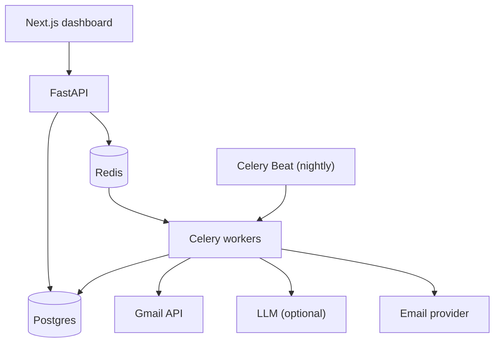

# Phase 1: MVP

**Theme:** Prove the "whoa moment".
**Timeline:** 3-4 weeks.
**Outcome:** A user connects Gmail (read-only), sees their real recurring subscriptions with a surprising monthly total, and gets an email before each renewal.

Related reading: [ROADMAP.md](../ROADMAP.md), [ARCHITECTURE.md](../ARCHITECTURE.md), [PIPELINE.md](../PIPELINE.md).

---

## Scope

### In scope
- Email + password signup/login (JWT).
- Connect one Gmail account via OAuth (read-only).
- Background ingestion of receipt/renewal emails into `transactions`.
- Recurrence detection into `subscriptions` (cadence, amount, next renewal, confidence).
- Merchant enrichment (LLM with cache, rule-based fallback).
- Simple rule-based status: active / trial / price-hike.
- Dashboard: total monthly and yearly spend, subscription list, subscription detail with charge history.
- Nightly renewal scan and reminder emails.
- Disconnect source and delete account.

### Out of scope (deliberately)
- Account Aggregator / bank data
- Auto-cancellation
- Budgeting and spending insights
- WhatsApp and push notifications
- Mobile app
- Multiple Gmail accounts per user
- Payments / paid plans

---

## Architecture for this phase



---

## Files built in this phase

```
backend/app/
  main.py
  core/config.py, core/db.py, core/security.py
  models/user.py, connection.py, transaction.py, subscription.py, alert.py
  schemas/auth.py, connection.py, subscription.py, alert.py
  api/deps.py, auth.py, connections.py, subscriptions.py, alerts.py
  services/gmail.py, detection.py, enrichment.py, alerts.py
  workers/celery_app.py, tasks.py
backend/alembic/versions/0001_initial.py
backend/tests/test_detection.py, test_gmail_parse.py

frontend/app/
  login, signup, connect, dashboard, subscriptions/[id], settings
frontend/components/
  SpendSummary, SubscriptionCard, SubscriptionList, ConnectGmailButton, AlertBadge
frontend/lib/api.ts, auth.ts, format.ts

infra/docker-compose.yml
.env.example
```

See [PROJECT_STRUCTURE.md](../PROJECT_STRUCTURE.md) for what each file does.

---

## Build plan (step by step)

### Week 1: Foundation
1. **Repo + infra** - create the monorepo, `docker-compose.yml` for Postgres and Redis, `.env.example`.
2. **Backend skeleton** - FastAPI app, settings, DB session, health check.
3. **Frontend skeleton** - Next.js + Tailwind, layout, API client.
4. **Data model** - SQLAlchemy models and the first Alembic migration (see [DATA_MODEL.md](../DATA_MODEL.md)).
5. **Auth** - signup/login, password hashing, JWT, `current_user` dependency; login/signup pages.

### Week 2: Getting data in
6. **Gmail OAuth** - consent URL endpoint, callback, AES-GCM token encryption, `connections` row.
7. **Celery setup** - worker + Beat config on Redis.
8. **Ingestion task** - `ingest_gmail`: search receipts, parse merchant/amount/date, dedupe by `raw_ref`, write `transactions`.
9. **Parser tests** - fixtures of real-looking receipt emails (Netflix, Spotify, Google One, Amazon Prime, etc.).

### Week 3: Making sense of it
10. **Detection engine** - pure `detect_subscriptions()` with thorough unit tests (monthly, yearly, irregular, price changes, one-off purchases that must not be flagged).
11. **Enrichment** - merchant lookup table + LLM normalization + cache + fallback.
12. **Dashboard UI** - spend summary, subscription list, detail page with history, connect screen showing sync status.

### Week 4: Reminders and polish
13. **Renewal scan** - nightly `scan_renewals`, `alerts` rows, reminder emails.
14. **Settings** - reminder lead time.
15. **Privacy flows** - disconnect source and delete account.
16. **README + run instructions**, then test end to end with real Gmail accounts.

---

## Detection test cases (must pass)

| Case | Input | Expected |
|---|---|---|
| Monthly | 3 charges of Rs 199, ~30 days apart | monthly, next renewal +30 days |
| Yearly | 2 charges of Rs 1,499, ~365 days apart | yearly |
| Price hike | Rs 149, 149, 199 monthly | monthly, flagged price_hike |
| One-off | single purchase | not a subscription |
| Irregular | 3 charges at random intervals and amounts | not a subscription (or low confidence) |
| Noisy merchant | "NETFLIX COM 94" and "NETFLIX.COM" | grouped as one merchant |

---

## Definition of done

- [ ] User can sign up, log in, and connect Gmail
- [ ] Sync runs in the background and the dashboard updates when it finishes
- [ ] Dashboard shows real subscriptions with monthly and yearly totals
- [ ] Detail page shows charge history
- [ ] Renewal reminder email arrives before the renewal date
- [ ] Disconnect and delete account remove all data
- [ ] Detection unit tests pass
- [ ] README explains local setup in under 10 minutes

---

## Validation milestone

Put it in front of 10-20 real people. Watch them connect Gmail and look at the total. The question to answer: **do most of them find at least one subscription they forgot about?** If yes, move to Phase 2. If no, fix detection coverage before adding features.
