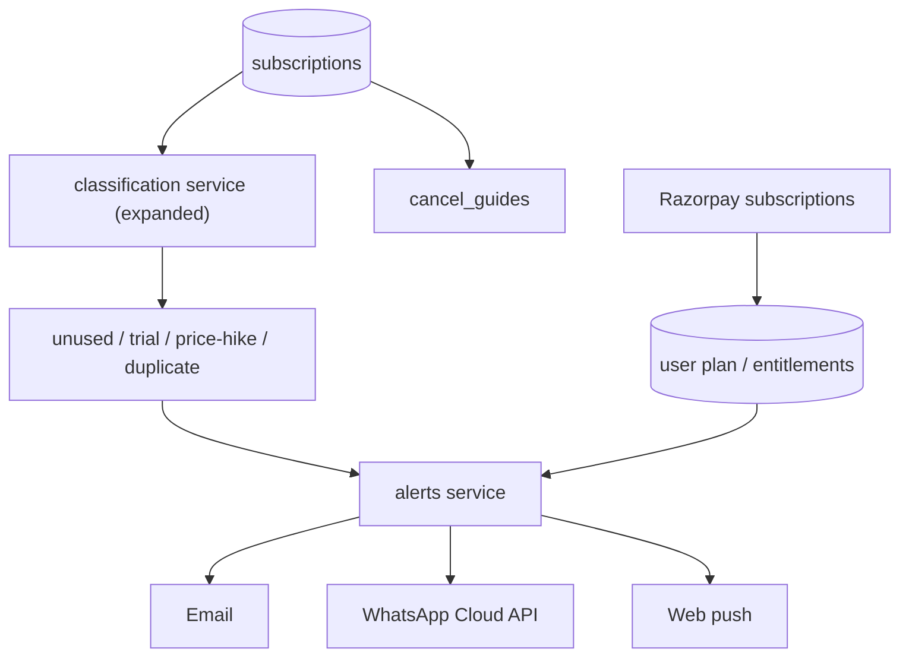

# Phase 2: Retention and Trust

**Theme:** Turn a one-time "whoa" into a habit, and start charging.
**Timeline:** 4-6 weeks.
**Outcome:** Users keep coming back because the app actively saves them money (smart flags, cancel help, timely alerts), and some of them pay for it.

Prerequisite: [Phase 1](PHASE_1_MVP.md) validated. Related reading: [ROADMAP.md](../ROADMAP.md), [PIPELINE.md](../PIPELINE.md).

---

## Scope

### In scope
- **Smarter classification**
  - `unused` detection (no engagement signal, e.g. no usage/activity emails from that service for N months).
  - Trial tracking: detect "your free trial ends on..." emails and alert before conversion.
  - Price-hike alerts with old vs new price.
  - Duplicate detection (e.g. two music services, two cloud storage plans).
- **Cancel guides**
  - Curated how-to-cancel steps and direct links for the top merchants.
  - Difficulty rating ("easy", "needs a call").
  - "I cancelled this" button that updates status and stops alerts.
- **More alert channels**
  - WhatsApp (WhatsApp Cloud API) and web push.
  - Weekly digest email: "This week you have 3 renewals totalling Rs 847."
- **Premium plan**
  - Free: one-time audit and dashboard.
  - Premium (around Rs 99/month): alerts, flags, cancel guides, digest.
  - Payments via Razorpay subscriptions.
- **Quality of data**
  - User can correct a subscription (rename, change amount/cadence, merge, or "not a subscription").
  - Corrections feed back into detection rules and the merchant table.

### Out of scope
- Account Aggregator / bank data (Phase 3)
- Fully automated cancellation on the user's behalf
- Budgeting

---

## Architecture changes



---

## New and changed files

```
backend/app/
  services/classification.py    unused / trial / price-hike / duplicate rules
  services/cancel_guides.py     lookup + serve guides
  services/notifications/
    email.py
    whatsapp.py
    push.py
  services/billing.py           Razorpay subscription handling + webhooks
  api/cancel_guides.py          GET /cancel-guides/{merchant}
  api/billing.py                checkout + webhook endpoints
  models/cancel_guide.py
  models/plan.py                user plan / entitlements
  models/correction.py          user corrections to detected subscriptions
  workers/tasks.py              + weekly_digest, trial_watch
alembic/versions/0002_retention.py

frontend/app/
  subscriptions/[id]/           + cancel guide panel, "I cancelled this", edit
  pricing/page.tsx
  settings/page.tsx             + channel choice (email / WhatsApp / push)
```

---

## New data

| Table | Purpose |
|---|---|
| `cancel_guides` | merchant_name, instructions, cancel_url, difficulty |
| `plans` | user_id, tier ('free' \| 'premium'), status, renews_at, provider_ref |
| `corrections` | user_id, subscription_id, field, old_value, new_value |
| `notification_settings` | user_id, channel, lead_days, digest_enabled, whatsapp_number |

---

## New API endpoints

| Method | Path | Purpose |
|---|---|---|
| GET | /cancel-guides/{merchant} | How-to-cancel steps |
| POST | /subscriptions/{id}/cancelled | Mark cancelled, stop alerts |
| POST | /subscriptions/{id}/corrections | User correction |
| POST | /billing/checkout | Start Razorpay subscription |
| POST | /billing/webhook | Razorpay events |
| PATCH | /alerts/settings | + channel and digest options |

---

## Build plan

1. **Corrections first** - let users fix mistakes; this improves data quality for everything else.
2. **Classification service** - unused, trial, price-hike, duplicate rules with unit tests.
3. **Cancel guides** - seed the top 50 merchants by frequency among your users.
4. **Weekly digest + trial watch** tasks.
5. **WhatsApp + push channels** (WhatsApp requires Meta business verification and approved message templates - start early).
6. **Premium plan + Razorpay** - gate alerts and flags behind entitlements.
7. **Pricing page** and upgrade prompts at the right moments ("We found Rs 650/month you could save - get alerts with Premium").

---

## Metrics for this phase

- Weekly active users and alert open/click rates.
- % of flagged subscriptions that users mark cancelled.
- Total monthly savings reported by users.
- Free to premium conversion rate.
- Churn of premium users.

---

## Definition of done

- [ ] Unused, trial, price-hike, and duplicate flags work and are tested
- [ ] Cancel guides for the top 50 merchants
- [ ] Users can correct or dismiss detected subscriptions
- [ ] Weekly digest and at least one extra channel (WhatsApp or push) live
- [ ] Premium plan purchasable via Razorpay, with entitlements enforced
- [ ] First paying users
