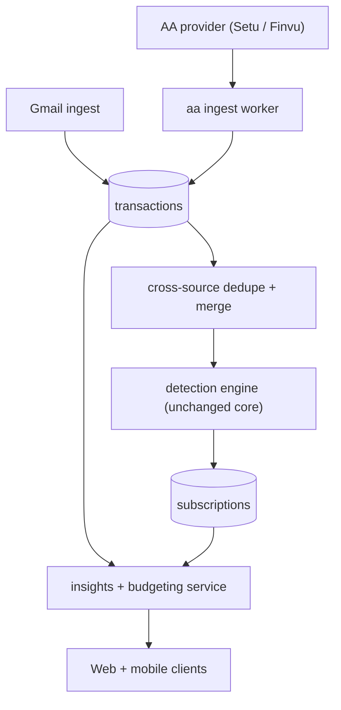
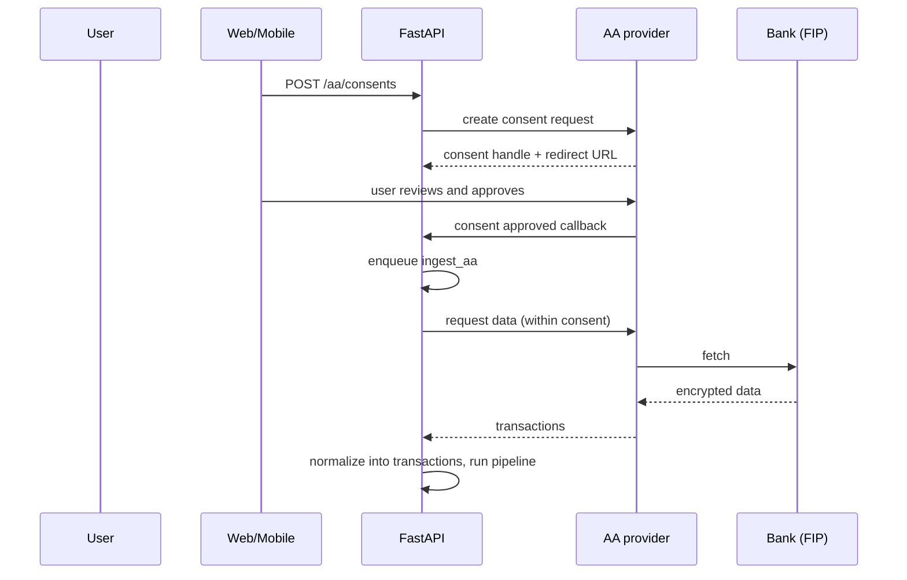

# Phase 3: Scale and the Full Financial Picture

**Theme:** Go from "subscription finder" to a personal-finance product.
**Timeline:** 2-3 months.
**Outcome:** Users connect their bank via India's Account Aggregator framework, see every recurring charge (not only the ones with email receipts), and use spending insights and budgeting. The metrics support a fundraise.

Prerequisite: [Phase 2](PHASE_2_RETENTION.md) shows retention and early revenue. Related reading: [ROADMAP.md](../ROADMAP.md), [SECURITY.md](../SECURITY.md).

---

## Scope

### In scope
- **Account Aggregator (AA) integration**
  - Integrate with a licensed AA provider (Setu, Finvu, or Perfios).
  - Consent flow: user approves sharing bank transactions for a defined purpose, date range, and duration.
  - Periodic fetch of transactions within the consent window.
  - Normalize bank transactions into the existing `transactions` table (`source = 'aa'`).
- **Cross-source merging**
  - The same Netflix charge can appear in both an email receipt and a bank transaction; dedupe and merge them into one subscription.
- **Spending insights**
  - Monthly spend by category, trends, and "your subscriptions went up 18% this year".
- **Budgeting**
  - Category budgets and alerts when nearing limits.
- **Assisted cancellation (carefully)**
  - For a small set of merchants with clear processes, prepare the cancellation (pre-filled emails/forms) for the user to confirm.
- **Monetization expansion**
  - Premium tiers, optional savings-share model, and relevant partner offers (cheaper plans, bundles).
- **Mobile app**
  - React Native/Expo client reusing the same API.

### Out of scope
- Moving money or making payments on the user's behalf (much heavier regulation).
- Credit products.

---

## Architecture changes



The detection engine itself does not change. The new work is a second ingest module, a merge step, and new services that read the same data.

---

## New and changed files

```
backend/app/
  services/account_aggregator.py   consent creation, status, data fetch, normalization
  services/merge.py                cross-source dedupe of transactions
  services/insights.py             category spend, trends
  services/budgets.py              budgets + threshold alerts
  services/assisted_cancel.py      prepared cancellation actions
  api/aa.py                        consent start, callback, status
  api/insights.py                  GET /insights/*
  api/budgets.py                   CRUD /budgets
  models/consent.py                AA consent artifacts
  models/budget.py
  workers/tasks.py                 + ingest_aa, refresh_consents, budget_watch
alembic/versions/0003_aa_insights.py

mobile/                            React Native / Expo app (new)
  app/
  components/
  lib/api.ts
```

---

## New data

| Table | Purpose |
|---|---|
| `consents` | user_id, provider, consent_handle, status, purpose, data_from, data_to, expires_at |
| `budgets` | user_id, category, monthly_limit, currency |
| `transactions` | + `category`, + `merged_into_id` for cross-source dedupe |

`connections.type` gains the value `'aa'`.

---

## AA consent flow



---

## New API endpoints

| Method | Path | Purpose |
|---|---|---|
| POST | /aa/consents | Start AA consent |
| GET | /aa/consents/{id} | Consent status |
| POST | /aa/callback | Provider callback |
| DELETE | /aa/consents/{id} | Revoke consent and delete data |
| GET | /insights/spend | Category spend + trends |
| GET/POST/PATCH/DELETE | /budgets | Budget management |

---

## Build plan

1. **Pick an AA provider** and complete onboarding; read the Financial Information User obligations.
2. **Consent flow** end to end in sandbox.
3. **AA ingest + normalization** into `transactions`.
4. **Cross-source merge** with tests (email + bank for the same charge become one).
5. **Insights** - category spend and trends.
6. **Budgets** - limits and threshold alerts.
7. **Assisted cancellation** for a handful of merchants.
8. **Mobile app** on the existing API.
9. **Fundraise prep** - metrics dashboard (activation, retention, savings found, revenue).

---

## Compliance notes

- Use a licensed AA; never collect bank credentials.
- Honor consent purpose, range, and expiry; stop fetching on revocation and delete data on request.
- Review current RBI / Sahamati guidelines before production.
- Update the privacy policy to cover bank data.

See [SECURITY.md](../SECURITY.md#9-account-aggregator-phase-3).

---

## Definition of done

- [ ] AA consent and data fetch work in production
- [ ] Email and bank transactions merge without double-counting
- [ ] Insights and budgets available to users
- [ ] Mobile app released
- [ ] Metrics support a fundraising story
